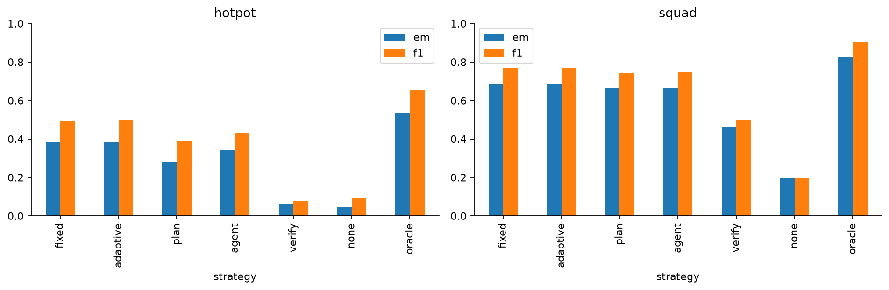
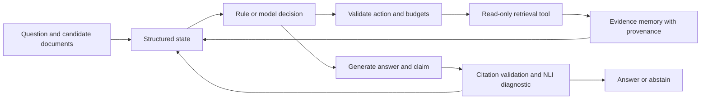

# Agentic RAG and tool-augmented reasoning

This project compares a fixed retrieval pipeline with a deterministic adaptive workflow, plan-and-execute retrieval, a model that selects retrieval tools, and verification-guided control. It tests whether additional evidence gathering improves answers and whether the gain justifies planning time, extra calls, and abstention errors.

The [measured benchmark](reports/benchmark.md), [full aggregate metrics](reports/metrics.csv), and [public research notebook](notebooks/01_public_agentic_rag_research.ipynb) contain the recorded results. The [research design](docs/research-design.md) explains the questions, development revisions, exact task boundaries, and metric definitions. Every aggregate is reconstructed from actual local per-question traces. This project does not assume that agents outperform fixed RAG.

<!-- measured-results -->
## Recorded results

The development stage selected `qwen17` for planning and `bm25` for the fixed reference. Each row below uses 128 held-out questions per dataset.

| Strategy | HotpotQA F1 | SQuAD F1 | HotpotQA evidence recall | HotpotQA p50 s |
| --- | ---: | ---: | ---: | ---: |
| fixed | 0.493 | 0.770 | 0.602 | 0.74 |
| adaptive | 0.496 | 0.770 | 0.637 | 0.80 |
| plan | 0.390 | 0.741 | 0.602 | 2.62 |
| agent | 0.431 | 0.748 | 0.660 | 6.93 |
| verify | 0.080 | 0.500 | 0.629 | 5.30 |



For hotpot, the tool-selecting agent's F1 difference from fixed RAG was -0.062 (paired 95% interval [-0.132, +0.014]); its median latency was 9.3 times the fixed reference.

For squad, the tool-selecting agent's F1 difference from fixed RAG was -0.022 (paired 95% interval [-0.048, -0.001]); its median latency was 10.0 times the fixed reference.

The verification gate answered 18.8% of hotpot questions, 21.9% of squad questions. Read coverage alongside full-set F1 and selective correctness. Source recall and NLI support do not establish faithful attribution.

No-retrieval and oracle-document controls, uncertainty intervals, all 11 ablations, failure traces, citation diagnostics and resource observations are available in the benchmark and notebook.
<!-- /measured-results -->

## Study design

The primary dataset is HotpotQA's pinned distractor validation release. SQuAD 2.0 supplies a complementary answerability task using its public v2.0 training release. Previous work used all articles in the locally available SQuAD development release, so that release could not provide an article-disjoint fresh study. Each dataset contributes 32 development, 32 validation, and 128 final-evaluation questions. These are local partitions of public releases, not official test scores.

Prior Project 2 question IDs are excluded. SQuAD articles are disjoint across partitions; HotpotQA is grouped by question and can still share Wikipedia pages. [Dataset validation](reports/data-validation.json) records original counts, sample IDs, hashes, duplicate counts, invalid supporting facts, and answerability. [Source locks](sources.lock.json) identify acquisition links, release versions, measured SHA-256 hashes, and CC BY-SA 4.0 terms. Raw documents are excluded from Git.

| Strategy | Evidence-gathering decision |
| --- | --- |
| Fixed RAG | One development-selected retrieval stage, then generation |
| Deterministic adaptive | BM25 followed by dense search or reranking when source diversity or question coverage is low |
| Plan-and-execute | A bounded model-generated plan of up to two actions, fixed before reading evidence |
| Tool-selecting agent | The model observes current evidence and chooses each next action |
| Verification-guided agent | Generated-claim checks can stop gathering, request another action, or reject the final proposal |

No-retrieval and oracle-document controls use the same question sets. The oracle receives gold document titles only and remains limited by context packing and generation. The deployable controller receives no gold answers or supporting-fact labels.

Development compares four retrieval backends and three planner models. Validation is diagnostic; it does not tune the prespecified verification thresholds. [The selection freeze](reports/selection-freeze.json) precedes held-out execution. Eleven prespecified ablations use the same first 32 evaluation questions per dataset: one step, two calls, a shorter context, disabled deduplication, two reduced tool registries, two verification thresholds, and empty, irrelevant, or injected first results. They are compared with the matching reference subset.

## Implementation



The registry provides BM25, normalized BGE semantic search, reciprocal rank fusion, MiniLM cross-encoder reranking, document lookup, bounded passage expansion, and title-mention graph navigation. Graph edges come from deterministic source-text matches; they are navigational hints rather than verified semantic relationships. Every passage retains an original source title and sentence offsets.

Python enforces action schemas, maximum steps and calls, generation-token budgets, context size, memory limits, retries, repeated-action rejection, and safe termination. The default limits are four steps, four calls, 4,096 generative input/output tokens, two passages per call, and 12 stored passages. The 440-token answer-prompt ceiling fits FLAN's 512-token input limit. The action model sees the latest three evidence snippets (180 characters each), candidate titles and a short recent trace; full text remains in memory. The registry contains no shell, filesystem, network, or code-execution tools. Retrieved text remains untrusted data. Synthetic injection tests establish only the particular boundaries tested; they do not establish production security.

| Module | Responsibility |
| --- | --- |
| `src/agentic_rag/controller.py` | State, structured actions, control strategies, budgets and stopping |
| `src/agentic_rag/tools.py` | Search, title links, source lookup, evidence memory and citation validation |
| `src/agentic_rag/models.py` | Local generation, embeddings, reranking and NLI adapters |
| `src/agentic_rag/data.py` | Authentic annotations, partitions and label-free task objects |
| `src/agentic_rag/study.py` | Staged selection, frozen evaluation and resumable traces |
| `src/agentic_rag/evaluation.py` | Answer/evidence metrics, aggregation and paired uncertainty |

## Models and hardware

The recorded host has an i7-13700HX (16 physical cores, 24 threads), 34.0 GB RAM, and an RTX 4060 Laptop GPU with 8,188 MiB VRAM. [The environment audit](reports/environment.json) records available RAM and disk at inspection; [runtime versions](reports/runtime-environment.json) record the packages actually imported. PyTorch 2.10.0 with CUDA 12.8, Transformers 4.57.3, and Sentence Transformers 5.2.0 perform local inference. [Resource records](reports/resources.json) and the notebook report actual loading times and process/GPU memory peaks.

FLAN-T5-base is the primary answer and claim generator. Qwen3-0.6B, Qwen3-1.7B, and FLAN are planner candidates. BGE-small-en-v1.5 provides embeddings, MS MARCO MiniLM-L6-v2 reranks, and DeBERTa-v3-small scores NLI. [The model lock](models.lock.json) records exact revisions, file hashes, sizes, licenses, and model cards. Generators use float16 on CUDA with no quantization; retrieval and NLI models use default float32. Qwen uses its non-thinking chat template. All generation is greedy here, which differs from Qwen's recommended sampling settings. Actual prompts and token counts stay in local traces. No paid APIs are used.

## What the metrics mean

Answer EM and token F1 compare original answer annotations. Evidence-document recall and supporting-fact recall score only text actually packed into the final prompt. Citation precision and recall compare cited source titles with dataset labels. Citations are assigned after generation using lexical overlap, so source-label agreement does not establish faithful attribution.

The claim diagnostic scores an actual FLAN-generated declarative claim against its cited passage using NLI entailment and contradiction. Claim rewriting can alter meaning, and NLI can accept irrelevant facts. The verification path also requires a literal answer anchor, which can reject valid paraphrases. The controller's support score defaults to zero when no claim was scored; the reliability report separately averages NLI only over actual claim proposals. A post-run conflict replay checks all packed windows, but those extra scores never alter the frozen agent's decisions. These are model estimates, separate from evidence labels and the explicitly identified assistant case review. No independent human support annotation was collected.

Coverage, selective correctness, false-answer rates and an always-abstain control accompany abstention results. Tool statistics distinguish failed dispatch, empty results, invalid actions, repeated actions and duplicate evidence. Extra annotated document gain measures recovery of evidence after the first call. Duplicate evidence is a waste proxy, not a causal judgment that a call was unnecessary.

Paired intervals use 2,000 bootstrap replicates, resampling questions for HotpotQA and complete articles for SQuAD. They are pointwise and unadjusted for multiple comparisons. End-to-end latency includes indexing, first-use passage encoding, planning, retrieval, answer and claim generation, and NLI. Loading is separate. CUDA and process peaks describe whole sequential processes, with warm caches and uncontrolled background load. Cached predictions retain original inference times.

## Reproduce

Use Python 3.12. From `Agentic RAG`, create a separate environment. Install the recorded CUDA Torch build from the PyTorch CUDA 12.8 index, then the recorded package inventory and project:

```powershell
python -m venv data/venv
data/venv/Scripts/python.exe -m pip install torch==2.10.0+cu128 --index-url https://download.pytorch.org/whl/cu128
data/venv/Scripts/python.exe -m pip install -r reports/requirements-lock.txt --extra-index-url https://download.pytorch.org/whl/cu128
data/venv/Scripts/python.exe -m pip install -e . --no-deps
data/venv/Scripts/python.exe scripts/run.py acquire.py
data/venv/Scripts/python.exe scripts/run.py begin_run.py
data/venv/Scripts/python.exe scripts/run.py audit_environment.py
data/venv/Scripts/python.exe scripts/run.py prepare_data.py
data/venv/Scripts/python.exe scripts/run.py audit_data_structure.py
data/venv/Scripts/python.exe scripts/run.py snapshot_runtime.py
data/venv/Scripts/python.exe scripts/run.py experiment.py pilot
data/venv/Scripts/python.exe scripts/run.py probe_plan.py
data/venv/Scripts/python.exe scripts/run.py generator_comparison.py
data/venv/Scripts/python.exe scripts/run.py experiment.py development
data/venv/Scripts/python.exe scripts/run.py experiment.py evaluation
data/venv/Scripts/python.exe scripts/run.py experiment.py ablations
data/venv/Scripts/python.exe scripts/run.py analyze.py
data/venv/Scripts/python.exe scripts/run.py analyze_conflicts.py
data/venv/Scripts/python.exe scripts/run.py probe_workflows.py
data/venv/Scripts/python.exe scripts/run.py record_source_provenance.py
```

Acquisition verifies existing files and downloads only missing files from pinned sources. `acquire.py --verify-only` performs no downloads. In this workspace it reads compatible weights from Project 2; a fresh checkout downloads them under this project's ignored `data/models`. `begin_run.py` preserves the published reports locally and permits an independent selection freeze and environment audit; use it only in a fresh checkout, before starting a new experiment. To resume this recorded workspace, omit that command and keep its checkpoints. `prepare_data.py` reconstructs the exact published partitions from their recorded IDs and verifies the full row hashes. The initial audit and previous-project preservation record describe this workspace; a new machine creates its own run record.

The recorded build uses existing local package overlays selected by `scripts/run.py` when outside a virtual environment. It disables downloads during inference and disables bytecode writes. A standalone environment uses its own installed packages. `scripts/pipeline.py` executes remaining research stages sequentially. The source/config/model identity and question-row hashes protect checkpoints against accidental reuse. Changed runs get new trace directories. [Source provenance](reports/source-provenance.json) maps the actual execution bytes to Git's LF-normalized publication bytes. Avoid changing frozen study sources during a run.

After reviewing the new answers, create fresh support judgments for their actual answer/evidence hashes. `scripts/run.py support_review.py` writes the real cases to `data/review/cases.json`. Write `data/review/judgments.json` as a list with each case's `tag`, `case_hash`, a `support` label (`supported`, `partial`, `unsupported`, or `unclear`), and a specific `rationale`. Record question relevance and whether the generated claim preserves the answer's meaning. Then run `scripts/run.py support_review.py --finalize`; it rejects judgments for changed cases. The recorded review is tied to the recorded predictions and is explicitly assistant-reviewed, without an independent human rater.

Run the notebook and publication checks after the review:

```powershell
data/venv/Scripts/python.exe scripts/run.py test -q -k "not public_notebook" --junitxml=reports/tests-notebook.xml
data/venv/Scripts/python.exe scripts/run.py build_notebook.py
data/venv/Scripts/python.exe scripts/run.py execute_notebook.py
data/venv/Scripts/python.exe scripts/run.py publish_notebook.py
data/venv/Scripts/python.exe scripts/run.py test -q --junitxml=reports/tests.xml
data/venv/Scripts/python.exe scripts/run.py audit_publication.py
```

The complete executed notebook is `notebooks/01_complete_agentic_rag_research.ipynb`, retained locally with its outputs and execution counts. The public copy is `notebooks/01_public_agentic_rag_research.ipynb`, with exactly the same source cells, cell types and order, and no saved outputs or execution counts. Builders and executors refuse to replace an executed notebook. Preserve it under `.local/` before a separate rerun. [Notebook verification](reports/notebook-verification.json) records both hashes and counts. Raw data, models, package files, indexes, traces, and the executed notebook are ignored by Git.

Runtime and hardware observations are recorded separately from the checkpoint key. Use a fresh checkout/cache when changing the device or installed inference packages.

## Answer your own question

Create a JSON mapping from source IDs to document text, then run:

```powershell
data/venv/Scripts/python.exe scripts/run.py answer.py --documents data/my-documents.json --question "Your question" --strategy verify
```

The result includes the answer or abstention, citations, source windows, generated claim, model support estimates, actions, tokens and timings. A nonempty answer from the deployable strategies must have a citation to packed evidence. Check the actual source and claim; a high NLI score alone does not establish correctness.

## Limitations and Future Improvements

The study uses small development samples, bounded candidate pools, short contexts, one host and a single sequential timing pass. SQuAD is not a multihop benchmark, title links are a simple graph, and the answer-model comparison is only a small development probe. Multi-step verification also changes generation opportunities, so its gains cannot be attributed solely to retrieval. Traces preserve every retrieval action and generation call, final proposal NLI probabilities, and cumulative verification time; intermediate NLI probabilities are not retained. The experiment does not establish open-domain performance, causal call necessity, independent faithfulness, or comprehensive attack resistance.

MuSiQue/2Wiki replication, larger quantized planners, repeated timing runs, independent support annotation and richer graph extraction remain unfinished. [The execution ledger](reports/execution-ledger.json) records completed configurations, failed stages, development revisions and remaining work. No cleanup removed prior experimental work. Projects 1 and 2 are unchanged, verified by the preservation manifest.

The study uses small locally practical planners and generators, bounded contexts, and HotpotQA and SQuAD partitions. Repeated model calls increased latency; model tool decisions also produced invalid or unnecessary actions. Verification-guided control answered only 18.8% of HotpotQA and 21.9% of SQuAD questions, so abstention reduced full-set F1. Context accumulated across retrieval steps, while the fixed candidate pools limited available evidence. SQuAD is an answerability benchmark rather than a multi-hop benchmark, and HotpotQA pages can recur across questions.

Future work can route only predefined difficult queries to an agent, reduce redundant retrieval steps, and verify decisions with explicit budgets. Any such routing should be compared against an equally tuned fixed system on fresh, source-aware samples. Better planning or larger models may help, but neither has been established by these results.

## Phase 1 results
The objective was to test whether dynamic evidence gathering justifies extra latency and tool failures. Separate local HotpotQA and SQuAD 2.0 partitions supplied 32 development, 32 validation, and 128 final questions per dataset. The study compared fixed/adaptive retrieval, planning, tool selection, and verification-guided control, with FLAN answer generation and development-selected qwen17 planning. Source/model locks retain exact provenance.

The [benchmark](reports/benchmark.md) reports HotpotQA fixed F1 0.493 versus agent 0.431, and SQuAD fixed 0.770 versus agent 0.748. HotpotQA agent evidence recall improved from 0.602 to 0.660 but answer quality did not. Fixed RAG remains the practical reference; deterministic adaptive F1 was 0.496 / 0.770, without a demonstrated meaningful quality gain. Agent median latency was 9.3 / 10.0 times fixed on HotpotQA / SQuAD. Invalid actions imposed additional costs. Verification-guided coverage fell to 18.8% / 21.9% and over-abstention harmed full-set quality.

Bounded evidence, small local cohorts, shared HotpotQA pages, one timing pass, and model-based support diagnostics limit generalization. More evidence recall alone did not establish better reasoning or supported attribution. Original notebooks and negative ablations remain the record.
