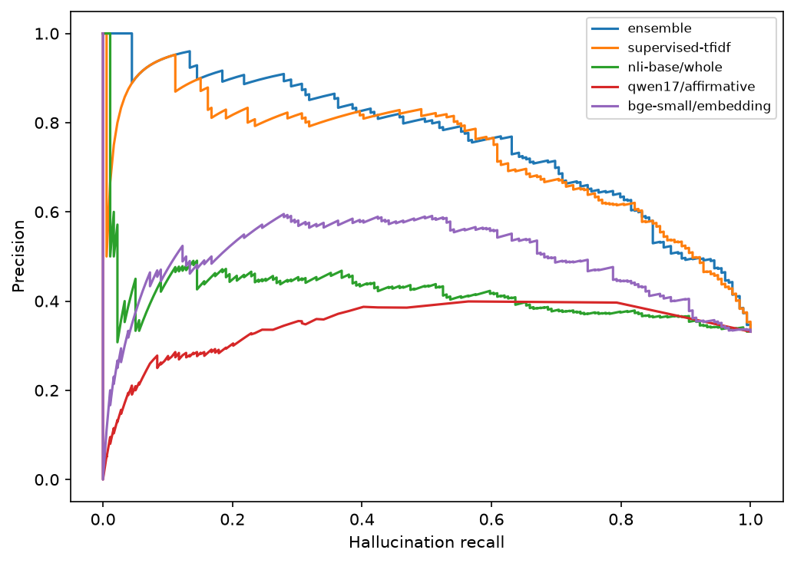
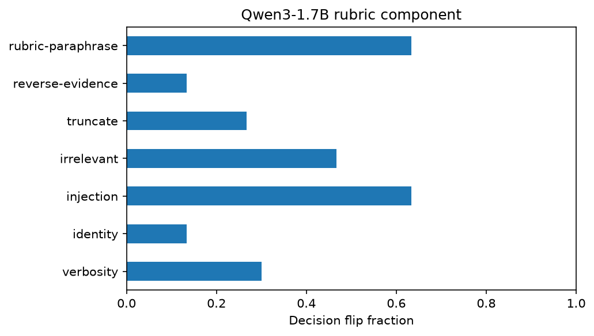
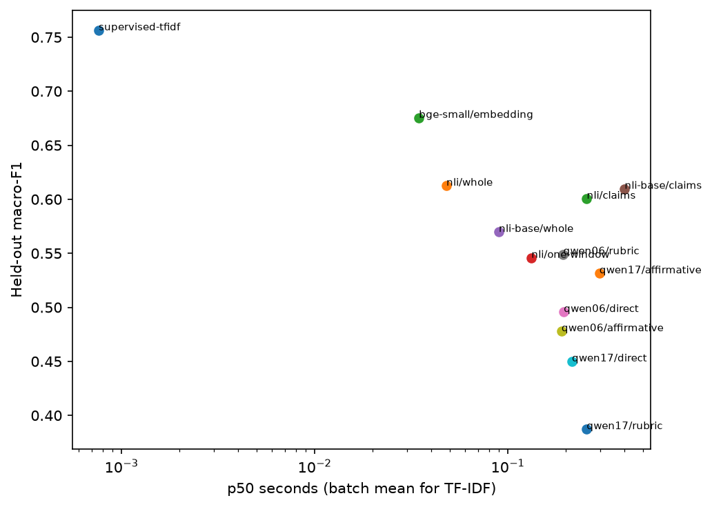

# LLM-as-a-Judge and RAG evaluation

This project tests whether local judges detect unsupported RAG answers against independent human annotations. It compares generative judges, specialized NLI cross-encoders, lexical and embedding proxies, a supervised linear classifier, calibration and an ensemble. It measures failures and resource costs alongside agreement.

The development-selected configuration is **`ensemble`**, with threshold `0.57752341`. On 540 responses from 90 source groups sampled from RAGTruth's official test split, its accuracy is **0.8056**, hallucination precision **0.7643**, recall **0.5978**, and F1 **0.6708**. This is response-level detection on a sampled test study. It is not span localization or a full official-test leaderboard result.

The [public notebook](notebooks/01_public_llm_judge_research.ipynb), [research design](docs/research-design.md), [metric definitions](docs/metrics.md), [selection freeze](reports/selection-freeze.json) and [full results](reports/heldout.json) provide the experimental record. The executed notebook and individual source passages remain local.

## Data and reference labels

[RAGTruth](https://github.com/ParticleMedia/RAGTruth), revision `c103204b9ce28d6bbad859304bf30de72b8ed8fe`, contains 17,790 responses from 2,965 sources. Its official split has 15,090 training and 2,700 test responses. Human hallucination spans supply the reference labels. Any span makes a response positive, including `implicit_true`: an assertion can be true yet unsupported by context. Conflict and baseless-information metadata are preserved locally. Absence of a span is not an independent factual-correctness, relevance or citation-support annotation.

All six responses from a source stay together. Exact duplicate evidence groups are excluded before sampling. Development uses 216 responses from 36 groups; validation uses 144 from 24; final evaluation uses 540 from 90. Each partition has equal source counts across QA, summarization and data-to-text. The [data audit](reports/data-validation.json) records counts, annotation types, duplicate checks and partition identities. Raw files, model files and local traces are ignored by Git.

[RAGBench](https://huggingface.co/datasets/galileo-ai/ragbench) provides complementary TechQA transfer labels. Its explainable adherence annotations are model-generated, so transfer agreement is reported separately from human-label agreement. The first 120 official test response rows sorted lexically by question ID are evaluated without retuning. They contain 60 original question IDs and 60 evidence groups, with two generated responses per group. Its reference annotators are `gpt-4-turbo-2024-04-09`. [Dataset locks](sources.lock.json) and [RAGBench lock](ragbench.lock.json) record URLs, revisions, licenses, hashes and sizes. Repository licenses do not supersede original source-content rights.

## Frozen selection and measured results

The development pilot exposed over-rejection by default-threshold Qwen and maximum-error sentence aggregation. It motivated a stronger NLI candidate, an affirmative rubric, mean aggregation and fit-score quantile thresholds. Those pilot results remain in [the record](reports/pilot.json).

Twenty-four development source groups fit thresholds and logistic calibration. Twelve other development groups select macro-F1. Validation is diagnostic and does not change the selection. An ensemble is eligible only after a selection gain greater than 0.01 over the best single approach. The freeze precedes held-out inference and includes source, configuration, model and partition identities. A comparator that performs better on the test set does not become the selected system retrospectively.

| Approach | Accuracy | Precision | Recall | F1 | Macro-F1 |
| --- | ---: | ---: | ---: | ---: | ---: |
| lexical | 0.7389 | 0.6044 | 0.6145 | 0.6094 | 0.7067 |
| exact-substring | 0.3315 | 0.3315 | 1.0000 | 0.4979 | 0.2490 |
| token-f1-proxy | 0.5370 | 0.4068 | 0.8659 | 0.5536 | 0.5364 |
| supervised-tfidf | 0.8037 | 0.7967 | 0.5475 | 0.6490 | 0.7564 |
| nli/whole | 0.6278 | 0.4567 | 0.6480 | 0.5358 | 0.6126 |
| nli/claims | 0.6148 | 0.4440 | 0.6425 | 0.5251 | 0.6006 |
| nli/claims-mean | 0.5741 | 0.3915 | 0.5140 | 0.4444 | 0.5495 |
| nli/one-window | 0.5463 | 0.4127 | 0.8715 | 0.5601 | 0.5458 |
| nli-base/whole | 0.5963 | 0.4141 | 0.5251 | 0.4631 | 0.5698 |
| nli-base/claims | 0.6130 | 0.4519 | 0.7877 | 0.5743 | 0.6097 |
| nli-base/claims-mean | 0.6759 | 0.5128 | 0.4469 | 0.4776 | 0.6214 |
| qwen06/direct | 0.5556 | 0.3257 | 0.3184 | 0.3220 | 0.4957 |
| qwen06/rubric | 0.5519 | 0.4013 | 0.7151 | 0.5141 | 0.5491 |
| qwen06/affirmative | 0.4852 | 0.3333 | 0.5531 | 0.4160 | 0.4779 |
| qwen17/direct | 0.4500 | 0.3361 | 0.6760 | 0.4490 | 0.4500 |
| qwen17/rubric | 0.3889 | 0.2733 | 0.5084 | 0.3555 | 0.3872 |
| qwen17/affirmative | 0.5315 | 0.3966 | 0.7933 | 0.5289 | 0.5315 |
| bge-small/embedding | 0.6981 | 0.5367 | 0.6536 | 0.5894 | 0.6754 |
| majority | 0.6685 | 0.0000 | 0.0000 | 0.0000 | 0.4007 |
| prevalence | 0.6685 | 0.0000 | 0.0000 | 0.0000 | 0.4007 |
| calibrated-nli | 0.6148 | 0.4440 | 0.6425 | 0.5251 | 0.6006 |
| ensemble | 0.8056 | 0.7643 | 0.5978 | 0.6708 | 0.7664 |

The selected system has Cohen's kappa 0.5358, MCC 0.5439, Brier score 0.1461, and 10-bin calibration error 0.0778. Raw conditional logits and NLI support scores are not calibrated human-correctness probabilities. ROC-AUC and average precision, task breakdowns, confusion matrices, false-positive and false-negative rates are in the complete results.

The macro-F1 difference from lexical overlap is 0.0598, with a paired 95% interval [0.0205, 0.0996]. The difference from TF-IDF is 0.0101, with interval [-0.0085, 0.0317]. The latter interval includes zero, so held-out evidence does not establish that ensemble complexity improves on the trained classifier. The classifier is a useful inexpensive comparator, with the same limitations about task and writing-style priors.

The global threshold generalizes poorly across task types. Hallucination recall is 83.3% for data-to-text, 36.0% for QA, and only 7.5% for summaries. Overall accuracy therefore does not establish a reliable general-purpose hallucination filter. Thresholds remain unchanged after observing this gap.

| Approach | Accuracy | Precision | Recall | F1 | Macro-F1 |
| --- | ---: | ---: | ---: | ---: | ---: |
| Data2txt | 0.7667 | 0.8051 | 0.8333 | 0.8190 | 0.7454 |
| QA | 0.8611 | 0.5000 | 0.3600 | 0.4186 | 0.6699 |
| Summary | 0.7889 | 0.7500 | 0.0750 | 0.1364 | 0.5081 |



Paired macro-F1 intervals resample complete source groups with 2,000 replicates. The [comparison intervals](reports/heldout.json) are pointwise and have no multiplicity adjustment. Claims of improvement require a positive held-out difference with uncertainty considered. Public benchmark scores are not placed beside these results because splits and scoring scopes differ.

## Model and architecture choices

| Model | Exact revision | License |
| --- | --- | --- |
| Qwen/Qwen3-0.6B | `c1899de289a04d12100db370d81485cdf75e47ca` | apache-2.0 |
| Qwen/Qwen3-1.7B | `70d244cc86ccca08cf5af4e1e306ecf908b1ad5e` | apache-2.0 |
| cross-encoder/nli-deberta-v3-small | `fa2804872c3b4bd748f38c0185cc85775361e735` | apache-2.0 |
| BAAI/bge-small-en-v1.5 | `5c38ec7c405ec4b44b94cc5a9bb96e735b38267a` | mit |
| MoritzLaurer/DeBERTa-v3-base-mnli-fever-anli | `6f5cf0a2b59cabb106aca4c287eed12e357e90eb` | mit |

Qwen3 models use float16, their non-thinking chat template, and single-token Yes/No conditional scoring. Direct, detailed rubric and affirmative-support prompts are compared. Evidence is capped at 2,400 tokenizer tokens; the full answer and instructions remain. This protocol avoids generated JSON parsing but provides no explanatory rationale. It is not a multi-pass reasoning judge.

NLI models use float32 and 512-token pairs. Sentence units retain offsets and the exact lexical-ranked evidence windows used. Whole-answer, one-window, maximum-error and mean-error aggregations are compared. Sentence splitting does not ensure atomic factual claims. Original span overlap supplies sentence-unit diagnostics, not independent atomic-claim labels. At the response-selected threshold, the stronger NLI sentence units have precision 0.1521, recall 0.4167, and F1 0.2228.

The trained TF-IDF baseline uses otherwise unused official training sources and excludes protected source groups, exact evidence and exact protected responses. It can learn style or task priors and is not a factual verifier. BGE CLS similarity, lexical coverage, exact substring matching and token F1 against context are weak support proxies. They are not reference-answer correctness scores.

The [trained-classifier lock](trained-classifier.lock.json) records its artifact hash, storage, training identity and scikit-learn version. Its parameters remain local and can be retrained from the pinned annotations.

Prometheus, 4B generation and neural fine-tuning are not tested. A larger unquantized generator leaves little working room in 8 GB VRAM; quantization would introduce another runtime to validate. The specialized approaches here are NLI cross-encoders. Ragas is not executed, and no numerical equivalence to it is claimed.

## Bias, calibration and transfer

Pairwise evaluation covers 30 source-matched pairs in both orders. Derived support-order accuracy is 0.6667; reversal consistency is 0.6667. These labels distinguish zero-span from positive-span responses, rather than human style preference. Self-preference is not established.

The [bias report](reports/bias-robustness.json) records sensitivity to repetition, model attribution, injected instructions, irrelevant context, evidence order, truncation and rubric paraphrase. Perturbations receive no fabricated human labels. Repeated checks use two uncached passes. These bounded probes do not establish general security or a causal explanation for each change.

An additional [selected-system diagnostic](reports/selected-bias.json) applies the frozen configuration to one response from each of 18 test source groups. It was added after freezing, using source IDs without inspecting test errors. It reports decision sensitivity, without assigning transformed human labels.



Selective evaluation reports coverage together with observed accuracy. It does not provide a guaranteed risk bound. The [transfer report](reports/transfer.json) uses the original frozen thresholds and coefficients against RAGBench's different annotation source.

| Approach | Accuracy | Precision | Recall | F1 | Macro-F1 |
| --- | ---: | ---: | ---: | ---: | ---: |
| lexical | 0.6000 | 1.0000 | 0.1111 | 0.2000 | 0.4667 |
| exact-substring | 0.4500 | 0.4500 | 1.0000 | 0.6207 | 0.3103 |
| token-f1-proxy | 0.4500 | 0.4500 | 1.0000 | 0.6207 | 0.3103 |
| supervised-tfidf | 0.5667 | 1.0000 | 0.0370 | 0.0714 | 0.3944 |
| nli/whole | 0.5750 | 0.6364 | 0.1296 | 0.2154 | 0.4620 |
| nli/claims | 0.5500 | 0.5000 | 0.1296 | 0.2059 | 0.4460 |
| nli/claims-mean | 0.5750 | 0.5517 | 0.2963 | 0.3855 | 0.5304 |
| nli/one-window | 0.5333 | 0.4848 | 0.5926 | 0.5333 | 0.5333 |
| nli-base/whole | 0.5500 | 0.5000 | 0.6481 | 0.5645 | 0.5495 |
| nli-base/claims | 0.6000 | 0.5375 | 0.7963 | 0.6418 | 0.5945 |
| nli-base/claims-mean | 0.6583 | 0.5867 | 0.8148 | 0.6822 | 0.6564 |
| qwen06/direct | 0.5250 | 0.4800 | 0.6667 | 0.5581 | 0.5223 |
| qwen06/rubric | 0.5000 | 0.4722 | 0.9444 | 0.6296 | 0.4302 |
| qwen06/affirmative | 0.4917 | 0.4493 | 0.5741 | 0.5041 | 0.4913 |
| qwen17/direct | 0.4167 | 0.3182 | 0.2593 | 0.2857 | 0.3964 |
| qwen17/rubric | 0.4833 | 0.4091 | 0.3333 | 0.3673 | 0.4654 |
| qwen17/affirmative | 0.4500 | 0.4500 | 1.0000 | 0.6207 | 0.3103 |
| bge-small/embedding | 0.6917 | 0.6545 | 0.6667 | 0.6606 | 0.6891 |
| majority | 0.5500 | 0.0000 | 0.0000 | 0.0000 | 0.3548 |
| prevalence | 0.5500 | 0.0000 | 0.0000 | 0.0000 | 0.3548 |
| calibrated-nli | 0.5500 | 0.5000 | 0.1296 | 0.2059 | 0.4460 |
| ensemble | 0.5917 | 0.8571 | 0.1111 | 0.1967 | 0.4615 |

At its frozen threshold, the ensemble's TechQA agreement accuracy is 59.2%, non-adherence recall is 11.1%, and F1 is 0.1967. This poor threshold transfer reinforces the cross-task limitation. The annotation source also changes, so these numbers cannot be interpreted as a change in independent human accuracy. The stronger NLI mean-sentence configuration reaches F1 0.6822 against the same model annotator, without becoming a newly selected primary system.

The [original-comparator analysis](reports/original-comparators.json) uses the dataset's precomputed Ragas, TruLens and GPT-3 support scores on exactly matched nonmissing rows. It is an exploratory post-freeze ranking comparison against the same model annotator. Those evaluators were not executed locally, and their original software versions and prompts are not independently verified. AUROC and average precision use inverted support scores; no new thresholds are fitted.

## Runtime and hardware

The recorded machine has an RTX 4060 Laptop GPU with 8,188 MiB VRAM, 34.0 GB RAM, 16 physical cores and 24 logical processors. About 662 GB disk space was free during the initial audit. Cached models were verified before reuse, and only one additional NLI model and one complementary dataset subset were downloaded. No paid APIs were used.

[Runtime measurements](reports/heldout.json) include loading, tokenization and evidence preparation within total inference time, p50/p95 latency, throughput, input tokens, process RSS and peak PyTorch GPU allocation. [The bounded runtime profile](reports/runtime-profile.json) separately measures tokenization, CPU/GPU execution and batching consistency. Cached traces retain original inference timings. PyTorch allocation is not total device memory, and process timing includes warm-up and uncontrolled background load.

[The selected CLI profile](reports/selected-runtime.json) measures three task-balanced development inputs in separate cold processes and verifies agreement with retained predictions. It includes imports and component loading. Each required model loads once per request and supplies its related features. Cold latency is not a persistent-service benchmark. Small-sample latency quantiles are descriptive.

The selected CLI's cold-process p50 is 30.87 seconds and p95 is 30.92 seconds, at 0.033 evaluations/second. The three-input probe peaks at 3.53 GiB PyTorch GPU allocation and 7.84 GiB process working set. These cold-process observations have a different scope from the warmed per-response comparator times below.

| Comparator | p50 s | p95 s | Evaluations/s | Peak GPU GiB |
| --- | ---: | ---: | ---: | ---: |
| supervised-tfidf | batch only | batch only | 1312.11 | not measured |
| nli/whole | 0.048 | 0.068 | 18.15 | 0.778 |
| nli/claims | 0.256 | 1.096 | 2.60 | 1.773 |
| nli/one-window | 0.133 | 0.604 | 4.50 | 1.773 |
| nli-base/whole | 0.090 | 0.133 | 9.94 | 0.965 |
| nli-base/claims | 0.403 | 1.241 | 1.94 | 2.073 |
| qwen06/direct | 0.195 | 0.421 | 4.27 | 2.320 |
| qwen06/rubric | 0.194 | 0.447 | 4.20 | 2.339 |
| qwen06/affirmative | 0.190 | 0.417 | 4.35 | 2.324 |
| qwen17/direct | 0.215 | 0.552 | 3.56 | 4.429 |
| qwen17/rubric | 0.256 | 0.614 | 3.23 | 4.448 |
| qwen17/affirmative | 0.298 | 0.723 | 2.79 | 4.433 |
| bge-small/embedding | 0.035 | 0.049 | 26.94 | 0.171 |




## Reproduce

Use Python 3.12 and an isolated environment. Install the matching CUDA Torch wheel from the official PyTorch index, then the recorded scientific packages and this project. [Imported versions](reports/runtime-environment.json) and [package inventory](reports/requirements-lock.txt) identify the observed environment. The package inventory includes incidental packages; the project dependencies define the required subset.

```powershell
cd LLM-as-a-Judge
python -m venv data/venv
data/venv/Scripts/python.exe -m pip install torch==2.10.0+cu128 --index-url https://download.pytorch.org/whl/cu128
data/venv/Scripts/python.exe -m pip install -e .
data/venv/Scripts/python.exe scripts/run.py begin_run.py
data/venv/Scripts/python.exe scripts/run.py acquire.py
data/venv/Scripts/python.exe scripts/run.py acquire_models.py
data/venv/Scripts/python.exe scripts/run.py audit.py
data/venv/Scripts/python.exe scripts/run.py acquire_complementary.py
data/venv/Scripts/python.exe scripts/run.py prepare.py
data/venv/Scripts/python.exe scripts/run.py pilot.py
data/venv/Scripts/python.exe scripts/run.py experiment.py development
data/venv/Scripts/python.exe scripts/run.py experiment.py heldout
data/venv/Scripts/python.exe scripts/run.py diagnostics.py
data/venv/Scripts/python.exe scripts/run.py transfer.py
data/venv/Scripts/python.exe scripts/run.py benchmark_runtime.py
data/venv/Scripts/python.exe scripts/run.py runtime_versions.py
data/venv/Scripts/python.exe scripts/run.py build_notebook.py
data/venv/Scripts/python.exe scripts/run.py execute_notebook.py
data/venv/Scripts/python.exe scripts/run.py publish_notebook.py
data/venv/Scripts/python.exe scripts/run.py build_report.py
data/venv/Scripts/python.exe scripts/run.py test -q
```

On this recorded workspace, `scripts/run.py` can read earlier projects' package overlays and pinned model files without changing them. A fresh checkout downloads the exact locked files into this project's ignored data directory. Prediction caches include source/configuration/model and input identities. Changed identities create separate trace directories; failures are recorded separately and never become successful scores. The freeze rejects source changes during held-out evaluation. To resume, run the same stage again. To conduct a new study, preserve existing reports, freeze and traces in a separate copy before changing the design.

Model variants and adapter limits are fixed in `src/llm_judge/study.py` and `models.py`. JSON controls sampling, seeds and threshold candidates; context-limit changes require corresponding implementation changes. Qwen records evidence-prefix truncation. Original NLI and embedding pair lengths were not instrumented, so their truncation fractions are reported as unknown rather than zero.

## Notebook and publication checks

The local notebook contains 39 cells, including 21 executed code cells and 63 saved outputs. It produces 9 aggregate figures. The public notebook has identical source cells, types and order, zero saved outputs, and null execution counts. Publication preserves the complete local notebook. [Notebook checks](reports/notebook-audit.json) verify these properties.

Tests cover span-to-response mapping, metrics, source/evidence separation, offsets, citation parsing, calibration leakage, perturbations, deterministic identities, actual NLI inference, failures and notebook equivalence. [Publication checks](reports/publication-audit.json) reconcile metrics with predictions, verify dataset/model hashes, compare previous tracked file bytes, scan staged secrets and excluded artifacts, and record Git-normalized hashes.

## Evaluate a local answer

Save evidence and an answer in UTF-8 files, then run:

```powershell
python scripts/run.py judge.py --evidence data/evidence.txt --answer data/answer.txt --question "Your question"
```

The CLI loads the development-selected configuration and prints a structured score, frozen threshold and decision. It checks input presence and frozen source identity. The distance from threshold is descriptive; it is not a calibrated review guarantee. Keep the evidence available when reviewing a flagged answer.

## Limitations and Future Improvements

This study evaluates evidence support against a specific annotation protocol. It does not establish independent correctness, relevance, context recall or citation-support accuracy. An answer can be correct without source support and faithful to an incorrect source. Separate annotation is required for those questions.

Development selection is uncertain with few source groups. Exact deduplication cannot remove all related passages, and pretraining contamination cannot be ruled out. Sentence units are not atomic claims. TF-IDF may exploit response style. Truncation and lexical evidence selection can hide necessary evidence. Calibration may shift across tasks. RAGBench agreement uses a model annotator, and the robustness subset is small. Larger specialized generative judges and quantized models remain open comparisons.

Earlier projects motivate the failure cases but supply no independent human labels. Projects 1–4 remain unchanged. Recommendations should follow the selected system's held-out errors, coverage and task breakdown rather than a larger model's name or the highest exploratory score.

## References and attribution

RAGTruth: Cheng Niu et al., 2024, [RAGTruth: A Hallucination Corpus for Developing Trustworthy Retrieval-Augmented Language Models](https://arxiv.org/abs/2401.00396). Dataset files come from ParticleMedia's pinned repository release under its recorded repository license, with upstream source rights preserved.

RAGBench: Robert Friel, Masha Belyi and Atindriyo Sanyal, 2024, [RAGBench: Explainable Benchmark for Retrieval-Augmented Generation Systems](https://arxiv.org/abs/2407.11005). The pinned Galileo dataset release declares CC BY 4.0. [Methodology notes](docs/related-work.md) and [BibTeX entries](docs/references.bib) provide the benchmark references. Exact model cards, licenses and file hashes are in the model lock.

The study evaluates smaller local judges under the available memory and runtime budget. Performance varied by task: hallucination recall was 36.0% for QA, 7.5% for summarization, and 83.3% for data-to-text. Threshold choices trade false positives against missed hallucinations, and calibration may not transfer across tasks or sources. The human-labeled RAGTruth sample is limited; model-generated RAGBench annotations are transfer diagnostics, not human ground truth.

The metrics describe response-level detection. The sentence-unit diagnostic is not atomic claim localization, and neither predicts whether each claim is supported by evidence. Future work can test task-aware calibration and evidence-conditioned evaluation on independently annotated samples, with per-task false-positive and false-negative rates. Claim-level verification needs its own labels and evaluation. A larger judge may fit poorly in local GPU memory and would not by itself guarantee better calibration or generalization.

## Phase 1 results
The objective was local unsupported-answer detection against human labels. RAGTruth supplied 540 final responses from 90 source groups, with separate development/validation groups. RAGBench TechQA transfer used model annotations and remains separate. Qwen 0.6B/1.7B, NLI cross-encoders, BGE, lexical proxies, supervised TF-IDF, calibration, and an ensemble were compared; original model/source locks retain revisions and provenance.

The [held-out results](reports/heldout.json) report selected ensemble accuracy 80.56%, hallucination F1 0.6708, and macro-F1 0.7664. Task recall was QA 36.0%, summary 7.5%, and data-to-text 83.3%. TF-IDF F1 was 0.6490 and macro-F1 0.7564. The paired ensemble macro-F1 advantage over TF-IDF was 0.0101 with 95% interval [-0.0085, 0.0317], so the added complexity has no established advantage. Preserve both comparators.

Sentence-unit diagnostic F1 was 0.2228; sentence segmentation is not true atomic-claim localization. Task-dependent thresholds, evidence truncation, style priors, small source cohorts, possible pretraining exposure, and poor model-label transfer limit generalization. Human span-derived support labels do not establish factual truth or citation quality. The public notebook and original negative results remain linked above.
