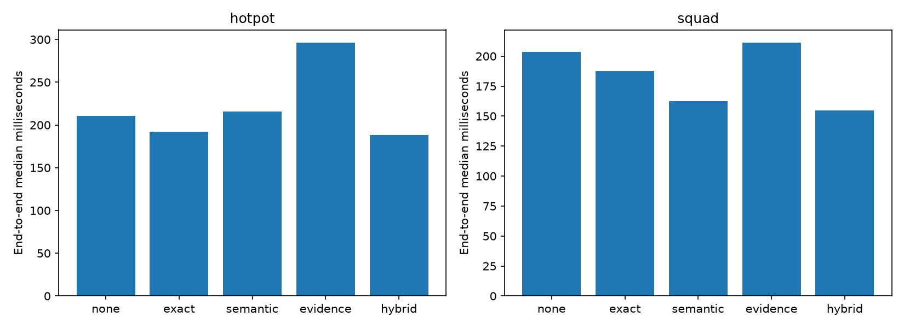
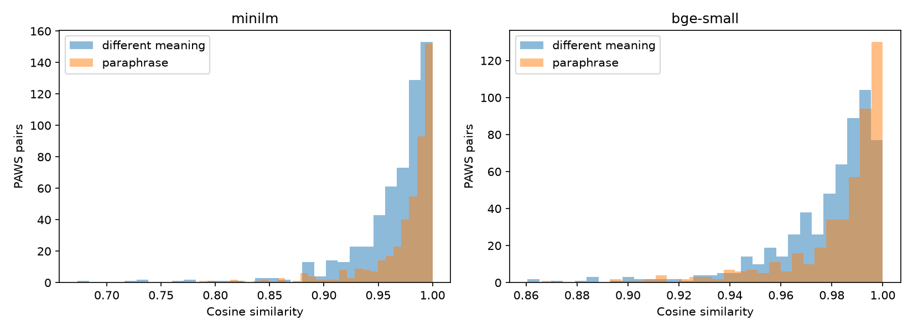

# Semantic caching for RAG

This study asks whether semantic caching reduces end-to-end RAG latency and computation while preserving query meaning, evidence freshness and authorization. It compares real local generation with exact answer caching, semantic answer caching, evidence caching and a tiered hybrid. Exact caching is the first comparator.

Development selected `flan-base` and `minilm`. Every tested useful cosine threshold made false accepts on the development PAWS sample. The strict answer threshold is therefore `1.001`, which disables semantic answer hits. This is a measured failure of the proposed acceptance rule, not evidence that semantic reuse is always impossible. Held-out strict pair acceptance was 0/1024; precision is undefined when nothing is accepted.

The [benchmark](reports/benchmark.md), [aggregate CSV](reports/metrics.csv), [paired intervals](reports/paired-intervals.json), [permissive ablation](reports/answer-reuse-ablation.json) and [complete public notebook](notebooks/01_public_semantic_caching_research.ipynb) retain beneficial and harmful outcomes. No paid APIs are used.

## Measured end-to-end results

| Dataset | Workload | Policy | F1 | Exact hit | Semantic hit | p50 ms | p95 ms | Calls avoided |
| --- | --- | --- | ---: | ---: | ---: | ---: | ---: | ---: |
| hotpot | mixed | none | 0.522 | 0.000 | 0.000 | 210.36 | 604.58 | 0 |
| hotpot | mixed | exact | 0.522 | 0.333 | 0.000 | 192.25 | 602.29 | 192 |
| hotpot | mixed | semantic | 0.522 | 0.333 | 0.000 | 215.72 | 578.71 | 192 |
| hotpot | mixed | evidence | 0.522 | 0.333 | 0.000 | 296.47 | 705.66 | 0 |
| hotpot | mixed | hybrid | 0.527 | 0.333 | 0.302 | 187.98 | 584.25 | 192 |
| hotpot | unique-heavy | none | 0.523 | 0.000 | 0.000 | 341.17 | 741.46 | 0 |
| hotpot | unique-heavy | exact | 0.523 | 0.100 | 0.000 | 335.64 | 727.99 | 24 |
| hotpot | unique-heavy | semantic | 0.523 | 0.100 | 0.000 | 362.20 | 827.98 | 24 |
| hotpot | unique-heavy | evidence | 0.523 | 0.100 | 0.000 | 370.56 | 809.28 | 0 |
| hotpot | unique-heavy | hybrid | 0.527 | 0.100 | 0.087 | 358.39 | 776.62 | 24 |
| hotpot | unique | none | 0.517 | 0.000 | 0.000 | 348.15 | 771.84 | 0 |
| hotpot | unique | exact | 0.517 | 0.000 | 0.000 | 345.18 | 785.10 | 0 |
| hotpot | unique | semantic | 0.517 | 0.000 | 0.000 | 371.51 | 814.95 | 0 |
| hotpot | unique | evidence | 0.517 | 0.000 | 0.000 | 371.19 | 816.06 | 0 |
| hotpot | unique | hybrid | 0.517 | 0.000 | 0.000 | 366.90 | 811.45 | 0 |
| squad | mixed | none | 0.613 | 0.000 | 0.000 | 203.36 | 551.65 | 0 |
| squad | mixed | exact | 0.613 | 0.333 | 0.000 | 187.54 | 570.29 | 192 |
| squad | mixed | semantic | 0.613 | 0.333 | 0.000 | 162.48 | 553.88 | 192 |
| squad | mixed | evidence | 0.613 | 0.333 | 0.000 | 211.41 | 577.82 | 0 |
| squad | mixed | hybrid | 0.618 | 0.333 | 0.307 | 154.92 | 539.55 | 192 |
| squad | unique-heavy | none | 0.606 | 0.000 | 0.000 | 425.15 | 709.81 | 0 |
| squad | unique-heavy | exact | 0.606 | 0.100 | 0.000 | 415.47 | 732.85 | 24 |
| squad | unique-heavy | semantic | 0.606 | 0.100 | 0.000 | 436.71 | 712.49 | 24 |
| squad | unique-heavy | evidence | 0.606 | 0.100 | 0.000 | 434.64 | 719.48 | 0 |
| squad | unique-heavy | hybrid | 0.615 | 0.100 | 0.096 | 433.77 | 705.82 | 24 |
| squad | unique | none | 0.607 | 0.000 | 0.000 | 414.78 | 734.39 | 0 |
| squad | unique | exact | 0.607 | 0.000 | 0.000 | 410.43 | 677.11 | 0 |
| squad | unique | semantic | 0.607 | 0.000 | 0.000 | 435.79 | 716.51 | 0 |
| squad | unique | evidence | 0.607 | 0.000 | 0.000 | 439.17 | 716.16 | 0 |
| squad | unique | hybrid | 0.607 | 0.000 | 0.000 | 435.11 | 697.44 | 0 |

On hotpot mixed traffic, exact caching changed median latency by -8.6% and p95 by -0.4%, avoided 192 generation calls across three trials, and changed F1 by +0.000. On squad mixed traffic, exact caching changed median latency by -7.8% and p95 by +3.4%, avoided 192 generation calls across three trials, and changed F1 by +0.000. All primary false-hit counts and family-reuse precision are recorded in the aggregate CSV; PAWS and adversarial annotation-incompatibility errors are separate denominators.

The primary matrix recorded 0 family-incompatible hits across all timed policy configurations. Exact caching hit 33.3% of mixed requests with family-reuse precision 1.000. Hybrid added semantic evidence hits on 30.2% of HotpotQA and 30.7% of SQuAD mixed requests; those hits still performed generation. These compatibility labels are separate from QA correctness and independently annotated PAWS equivalence.

Three sequential trials use identical within-trial request orders across policies and fresh cache state per policy, workload and dataset. Mixed traffic contains 64 first requests, 64 exact repeats and 64 synthetic wrappers per dataset and trial. Unique-heavy traffic contains 64 first requests plus eight repeats and eight wrappers. Unique traffic has 64 first requests. Synthetic wrappers preserve the original question behind a request prefix; they are not independent human paraphrases.

Each no-cache request performs real retrieval and generation. Exact answer hits avoid generation. Strict semantic answer caching adds embedding/search overhead after exact misses while accepting no semantic answers. Evidence caching always generates afresh. Hybrid tries exact answers, strict semantic answers, then evidence reuse at a prespecified experimental threshold of 0.95. A semantic evidence hit can save retrieval while still generating a wrong answer from unsuitable passages.

Read p95 alongside p50: misses can dominate the tail even when many repeats become cheap. [Paired intervals](reports/paired-intervals.json) resample HotpotQA question families and SQuAD articles with 2,000 replicates. HotpotQA evaluation families can share source pages, so these intervals may understate document-level dependence. They describe this sample and host; they do not establish production tail-latency guarantees. Reuse precision measures whether a compatible question family was reused, separately from answer EM/F1. A correct cache decision can repeat an incorrect baseline answer.

[Per-trial metrics](reports/trial-metrics.json) retain all 90 individual timing outcomes. Observed host drift is not removed or corrected by selecting faster trials; pooled timings and intervals must be interpreted alongside this variation.

Because the strict policy accepts no semantic answers, a measured latency advantage over exact caching cannot be attributed to semantic answer reuse. Both policies avoid the same exact-repeat generation calls; timing drift and lookup overhead remain separate effects.

Observed timing drift motivated an additional [adjacent-pair diagnostic](reports/adjacent-latency.json) after the freeze. Across 16 existing held-out questions, fresh no-cache median latency was 140.87 ms and a warm exact hit was 0.26 ms, with 16/16 identical answers. The probe alternated baseline/hit order after one real seeding request per family. It is a conditional warm-hit diagnostic, not a traffic-level speedup estimate, and did not change selection.



## Data and experimental separation

The study uses authentic HotpotQA distractor validation and SQuAD 2.0 public training records. Each contributes 24 development and 64 held-out QA questions. Prior experiment question IDs are excluded; SQuAD additionally excludes prior articles. Selected source documents are disjoint between this study's development and held-out pools. HotpotQA is a bounded distractor-corpus task; SQuAD retrieves over all paragraphs in the question's article. Neither is global open-domain QA.

The held-out SQuAD sample contains 24 unanswerable questions across 57 articles. The notebook reports answerability and abstention separately from overall QA quality.

PAWS-Wiki Labeled Final contributes 512 development and 1,024 held-out pairs. The pairs are generated and human-labeled for equivalence and fluency. They do not provide QA answer labels. Normalized sentence overlap is removed across splits, but source-page mapping is unavailable, so PAWS document-level separation cannot be established. QQP was considered and excluded because its reconstruction conditions add work without resolving QA equivalence.

[Source locks](sources.lock.json) record release URLs, revisions, measured checksums, licenses and original sample counts. [Dataset validation](reports/data-validation.json) records genuine IDs, selection counts, answerability and full-row hashes. HotpotQA and SQuAD are CC BY-SA 4.0. PAWS uses its supplied [Google dataset license](https://github.com/google-research-datasets/paws/blob/master/LICENSE). The PAWS upstream archive returned HTTP 403; acquisition uses pinned mirror Parquet files. Raw records remain local.

## Equivalence and false matches

MiniLM and BGE produce normalized 384-dimensional embeddings, with maximum sequence length 256 and symmetric unprefixed encoding. TF-IDF unigrams/bigrams are a third feasible embedding method, not a third pretrained neural encoder. Its held-out vocabulary and IDF are fitted on development text only. [Development sweeps](reports/embedding-development.json) select the strict gate; [held-out sweeps](reports/equivalence-evaluation.json) measure errors without retuning it.



The numeric and negation guard rejects selected token changes but misses entities, role reversals and temporal wording. [Synthetic stress tests](reports/synthetic-stress.json) disclose their origin. The separate QA ablation warms a cache with a genuine source question, then asks either a wrapper or a nearby different authentic SQuAD question with disjoint annotated answers. Similarity selects the adversarial neighbor within the same article. Thresholds 0.8 and 0.95 expose unsafe permissive behavior; the frozen strict threshold is also retained. Different annotation strings are an incompatibility proxy, not independent human equivalence judgments. Actual QA degradation is measured against the fresh-generation answer and original answer annotations.

The ablation reports the post-seeding query latency; seeding is excluded there. Primary end-to-end workloads include their first requests. [The ID manifest](reports/ablation-manifest.json) records the actual source and target pairs.

| Encoder | Threshold | Guard | Accepted pairs | False accepts | Precision |
| --- | ---: | --- | ---: | ---: | ---: |
| minilm | 0.8 | yes | 999 | 549 | 0.450 |
| minilm | 0.95 | yes | 825 | 435 | 0.473 |
| bge-small | 0.8 | yes | 1009 | 557 | 0.448 |
| bge-small | 0.95 | yes | 915 | 503 | 0.450 |
| tfidf | 0.8 | yes | 881 | 482 | 0.453 |
| tfidf | 0.95 | yes | 372 | 191 | 0.487 |

| Query type | Threshold | Policy | Hits / requests | Incompatible annotation proxy | F1 | Fresh F1 | p50 ms |
| --- | ---: | --- | ---: | ---: | ---: | ---: | ---: |
| nearby_authentic | 0.8 | semantic | 6 / 16 | 6 | 0.540 | 0.840 | 329.10 |
| nearby_authentic | 0.8 | evidence | 6 / 16 | 6 | 0.840 | 0.840 | 357.76 |
| nearby_authentic | 0.95 | semantic | 1 / 16 | 1 | 0.778 | 0.840 | 357.18 |
| nearby_authentic | 0.95 | evidence | 1 / 16 | 1 | 0.840 | 0.840 | 375.62 |
| nearby_authentic | 1.001 | semantic | 0 / 16 | 0 | 0.840 | 0.840 | 370.47 |
| nearby_authentic | 1.001 | evidence | 0 / 16 | 0 | 0.840 | 0.840 | 380.66 |
| synthetic_wrapper | 0.8 | semantic | 16 / 16 | 0 | 0.717 | 0.787 | 19.83 |
| synthetic_wrapper | 0.8 | evidence | 16 / 16 | 0 | 0.779 | 0.787 | 435.11 |
| synthetic_wrapper | 0.95 | semantic | 16 / 16 | 0 | 0.717 | 0.787 | 20.28 |
| synthetic_wrapper | 0.95 | evidence | 16 / 16 | 0 | 0.779 | 0.787 | 440.07 |
| synthetic_wrapper | 1.001 | semantic | 0 / 16 | 0 | 0.787 | 0.787 | 437.04 |
| synthetic_wrapper | 1.001 | evidence | 0 / 16 | 0 | 0.787 | 0.787 | 436.48 |

## Architecture and safety

| Component | Implementation |
| --- | --- |
| Reference RAG | BM25 over overlapping 128-word passages, stride 96, top three passages; greedy FLAN generation, 480 input tokens, 48 new tokens |
| Exact answer cache | Unicode NFC and whitespace normalization; dictionary/LRU; meaningful text preserved |
| Semantic answer cache | Normalized cosine search, development-selected threshold, numeric/negation guard |
| Evidence cache | Reuse source passages, then fresh generation |
| Hybrid | Exact answer, strict semantic answer, then experimental semantic evidence fallback |
| Freshness | Full corpus digest plus current source existence, visibility, version, timestamp and content hash |
| Authorization | Tenant, user, allowed-document set and permission epoch in scope; current source checks before returning content |
| Persistence | Signed JSON in SQLite WAL transactions; verified restoration; FAISS index restored incrementally from stored entries |

Corpus scopes are per task candidate pool. Different supplied corpora cannot share answers. Full-corpus invalidation also covers newly introduced competing evidence, at the cost of invalidating unaffected entries. The application must ingest upstream changes before cache checks can detect them.

[Controlled probes](reports/security-freshness.json) rejected all 11 stale or incompatible requests. Tests cover cross-tenant/user scopes, unknown permissions, revoked/deleted/changed documents, model/prompt changes, TTL, LRU capacity, concurrent insertion, restoration, serialization and modified persisted entries. SQLite HMAC detects storage changes using an external local key. Trusted writers and signing keys remain part of the threat boundary. This does not establish protection against stolen credentials, compromised writers, malicious source ingestion, prompt injection or timing side channels.

The incorrect-trusted-insertion test deliberately retains a failure: a validly inserted wrong answer is reused. Signing verifies integrity, not answer truth. Compatible exact reuse can also repeat a wrong baseline answer, so cache-hit precision must be read alongside QA EM/F1.

The in-process lock protects cache operations; concurrent misses can duplicate inference. SQLite writes are transactional, while index state belongs to one process. No distributed consistency or single-flight guarantee is claimed. Recovery tests close/reopen storage and do not simulate power loss. See the [cache contract](docs/cache-contract.md) for tested and untested boundaries.

## Backend, capacity and resource results

[Backend measurements](reports/backend-comparison.json) compare NumPy, FAISS, signed SQLite with both search paths, and persistent local Qdrant at 512 synthetic normalized vectors of dimension 384. Incremental insertion, exact/semantic lookup, serialized bytes, process RSS deltas and restart are measured. Python payload and scope handling differ, so these results do not isolate engine performance. Qdrant scope filtering and restart passed after its Windows dependency setup. Redis was absent; installing a service was disproportionate to this local study.

| Backend | Insert p50 ms | Semantic lookup p50 ms | Restart ms | Disk bytes |
| --- | ---: | ---: | ---: | ---: |
| numpy | 0.058 | 9.636 | 0.00 | 0 |
| faiss | 0.070 | 2.643 | 0.00 | 0 |
| sqlite-numpy | 0.846 | 11.180 | 103.79 | 4526080 |
| sqlite-faiss | 1.123 | 4.085 | 98.49 | 4526080 |
| qdrant-local | 4.633 | 4.970 | 58.19 | 2122246 |

[Eviction experiments](reports/eviction.json) compare capacities 8, 32, 128 and 512 under LRU and controlled-clock TTL, with a shift to new keys and a return to the original set. The cache does not rebuild its entire FAISS index on insertion. Persistent restoration rebuilds once at startup.

The host has an i7-13700HX, 34.0 GB RAM and an RTX 4060 Laptop GPU with 8,188 MiB VRAM. [The audit](reports/environment.json) records actual free memory, disk and previous artifact sizes. [Model locks](models.lock.json) pin exact revisions and every reused file hash. FLAN-base uses float16 on CUDA; encoders use their default float32. [Development model comparison](reports/generator-development.json) measures FLAN-small/base QA and latency; the selected generator stays fixed thereafter.

Across 48 development questions, FLAN-base achieved F1 0.500 versus 0.333 for FLAN-small. Their measured median latencies were 196.75 and 119.85 ms respectively. The higher-quality base model was retained for every cache comparison.

Recorded encoder loading took 2353.1 ms and generator loading 854.1 ms. These are separate from the warm-model request results. [Resource measurements](reports/resources.json) include loaded/final process RSS and CUDA peak allocation. Generation calls avoided and CUDA event elapsed time avoided are reported per configuration. They are computation proxies, not energy or monetary savings. Background load, allocator reuse and sequential policy order affect timing.

Loading uses fresh model instances with an uncontrolled, likely warm OS file cache. Full cold-boot startup and library import costs are not measured by the model constructor timers.

Loaded process RSS was 2.15 GiB; final process RSS was 1.32 GiB; peak CUDA allocation was 0.67 GiB. First unique requests, exact repeats and wrappers are separately aggregated in [cold/warm phases](reports/cold-warm-phases.json).

## Experiments actually executed

The final ledger contains 90 timed trial files and 10080 request outcomes. Executed stages include baseline generation; exact caching; development and held-out equivalence sweeps; annotated and synthetic false-match diagnostics; evidence reuse; freshness/invalidation fixtures; local backend and restart comparisons; capacity/TTL/traffic-shift probes; authorization and poisoning tests; and frozen held-out end-to-end comparisons. The separate permissive QA ablation does not change the frozen configuration.

The adjacent-pair diagnostic adds 16 families and 48 real requests including seeding. Fixed policy order and observed host drift limit causal interpretation of the primary timing differences.

The hybrid implementation was corrected during development. A later prompt audit found that whole-prompt truncation could remove questions after long evidence. The final prompt reserves the complete question and suffix, then packs evidence only within the remaining budget. Cache scopes were also hardened to include exact generator and embedding revisions. Model selection and all final trials were rerun after these corrections. Superseded traces remain local. [Hybrid revision](reports/development-revision.json), [identity extension](reports/identity-extension.json), [prompt revision](reports/prompt-revision.json), and [scope revision](reports/scope-revision.json) record the changes. No superseded trial enters final aggregates.

## Notebook and reproduction

The complete executed local notebook is `notebooks/01_complete_semantic_caching_research.ipynb`. It has 46 cells, 23 executed code cells, 51 saved outputs and 4 inline figures. The [public notebook](notebooks/01_public_semantic_caching_research.ipynb) has identical cell types, sources and order, with all outputs and execution counts cleared. [Verification](reports/notebook-verification.json) records both file hashes. The executed notebook is never stripped or overwritten.

Use Python 3.12 and an isolated environment. Install the recorded CUDA Torch build, then the [runtime inventory](reports/requirements-lock.txt), then this package. A fresh checkout downloads missing weights into this project's ignored data directory and updates local path bindings; begin a separate selection freeze for that environment. Existing weights are verified and reused without duplicate downloads. No previous project implementation is imported. `prepare_data.py` reconstructs the exact published IDs without requiring previous project internals.

```powershell
python -m venv data/venv
data/venv/Scripts/python.exe -m pip install torch==2.10.0+cu128 --index-url https://download.pytorch.org/whl/cu128
data/venv/Scripts/python.exe -m pip install -r reports/requirements-lock.txt --extra-index-url https://download.pytorch.org/whl/cu128
data/venv/Scripts/python.exe -m pip install -e . --no-deps
data/venv/Scripts/python.exe scripts/run.py acquire.py
data/venv/Scripts/python.exe scripts/run.py prepare_data.py
data/venv/Scripts/python.exe scripts/run.py begin_run.py
data/venv/Scripts/python.exe scripts/run.py audit_environment.py
data/venv/Scripts/python.exe scripts/run.py snapshot_runtime.py
data/venv/Scripts/python.exe scripts/run.py test -q --ignore=tests/test_publication.py --junitxml=reports/tests.xml
data/venv/Scripts/python.exe scripts/run.py backend_experiments.py
data/venv/Scripts/python.exe scripts/run.py pipeline.py
data/venv/Scripts/python.exe scripts/run.py paired_latency_probe.py
data/venv/Scripts/python.exe scripts/run.py build_notebook.py
data/venv/Scripts/python.exe scripts/run.py execute_notebook.py
data/venv/Scripts/python.exe scripts/run.py publish_notebook.py
data/venv/Scripts/python.exe scripts/run.py finalize_readme.py
data/venv/Scripts/python.exe scripts/run.py test -q --junitxml=reports/tests.xml
data/venv/Scripts/python.exe scripts/run.py audit_publication.py
```

In this recorded workspace, omit `begin_run.py` and resume only unchanged identities. Trial checkpoints are written atomically after a complete timed trial. Interrupted trials rerun; completed trials are reused only with matching source/configuration/partition/order identity. Checkpoints do not substitute predictions for inference inside a timed trial. The launcher's read-only package overlays are workspace conveniences; the isolated environment uses its own packages.

## Limitations and Future Improvements

The QA sample is small, candidate corpora are bounded, and timing comes from one host. Genuine annotated QA paraphrases were not acquired; wrappers test a narrow meaning-preserving transformation. PAWS is a different domain and lacks source-page grouping here. The strict zero-error development rule rejected useful semantic reuse, while permissive settings reveal the risks rather than establish a deployable threshold. The hybrid evidence gate remains experimental.

No third neural encoder, larger generator study, distributed backend, production traffic capture, independent human QA-equivalence review, energy measurement or cost model is included. Backend tests measure this Python implementation and payload layout. Security fixtures establish only their tested properties. These limits constrain the conclusions and remain part of the published result.

The workload covers selected QA tasks and PAWS-Wiki equivalence pairs. Similarity thresholds were sensitive: every useful tested answer-reuse threshold admitted false matches on development data, so the strict policy disabled semantic answer hits. High embedding similarity measures closeness in vector space; it does not show that two questions have interchangeable answers. A cache hit rate alone therefore says little about correctness.

Exact caching preserved the stored answer for an identical key. Semantic answer reuse can return a plausible answer to a subtly different question, while evidence caching still depends on fresh retrieval and generation. Reported latency came from a local workload with observed timing drift, so small differences are difficult to attribute. The study's workload and query mix do not establish performance for other applications.

Future work can test an explicit answer-equivalence check before reuse and evaluate policies by both accepted-hit correctness and total compute/latency saved after validation cost. Broader paraphrase-rich and adversarial workloads would help measure the trade-off. These safeguards remain proposed, not validated.

## Phase 1 results
The objective was lower end-to-end cost without changing query meaning, freshness, or authorization. FLAN-T5-base and MiniLM were development-selected on separate HotpotQA/SQuAD partitions; each dataset supplied 24 development and 64 held-out QA questions. PAWS-Wiki supplied 512 development and 1,024 held-out equivalence pairs. It does not provide answer-equivalence labels.

The [benchmark](reports/benchmark.md) reports exact hits on 33.3% of mixed requests, with median latency reductions of 8.6% on HotpotQA and 7.8% on SQuAD, approximately 8% under tested conditions. Exact caching is the recommended reference. The strict semantic answer threshold 1.001 produced zero semantic answer hits. MiniLM cosine 0.95 with the guard incorrectly accepted 435 nonequivalent PAWS pairs among 825 accepted pairs; accepted-pair precision was 0.473. [Permissive reuse](reports/answer-reuse-ablation.json) harmed QA F1, while evidence reuse with fresh generation was safer in the limited 16-query adversarial sample.

Synthetic wrappers are not independent paraphrases. Sequential host timing drift, limited adversarial coverage, answer-annotation incompatibility proxies, and unavailable PAWS source-page grouping limit the conclusions. Exact-hit compatibility does not prove the reused answer is correct. Historical provenance, freshness controls, notebooks, and failed thresholds remain unchanged.
